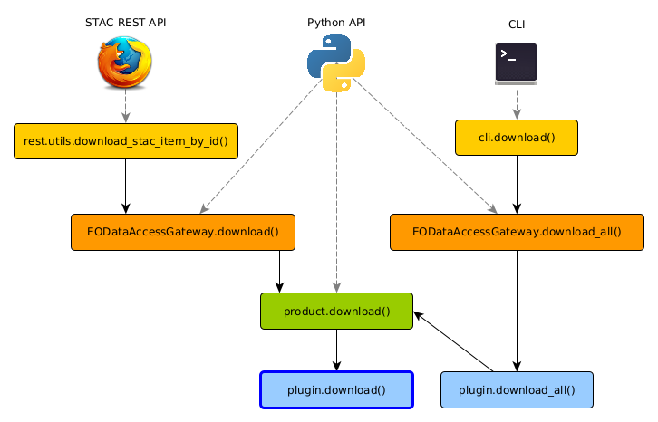

.. module:: eodag.plugins.download

================
Download Plugins
================

Download plugins must inherit the following class and implement :meth:`download`:

.. autoclass:: eodag.plugins.download.base.Download
   :members:

This table lists all the download plugins currently available:

.. autosummary::
   :toctree: generated/

   http.HTTPDownload
   aws.AwsDownload

-------------------
Assets and ordering
-------------------

Download plugins receive a product and an optional ``asset`` filter. Without a
filter, a ``download_link`` asset takes precedence over all other assets. If it
does not exist, all available assets are selected. An explicit filter matches
asset keys with ``re.fullmatch`` (with a literal-key fallback), not URLs.
Streaming downloads use the same selection rule. ``ignore_assets`` is no longer
a supported configuration option.

Each selected offline asset is ordered before downloading. Order URLs and state
belong to that asset: ``eodag:order_link``, ``eodag:status_link``, ``order:id`` and
``order:status``. The statuses are ``orderable``, ``ordered``, ``succeeded`` and
``failed``; a missing status means the asset is online. Failed orders are not
submitted again automatically, though their status can still be polled.

Search configurations create assets with ``assets_mapping``. Download order
responses instead use singular ``asset_mapping`` to update the ordered asset,
and ``metadata_mapping`` to update product properties. See :ref:`params_mapping`
for mapping examples and parse-only helpers.

---------------------
Local state and cache
---------------------

Plugins keep the remote URL in ``href`` and write the downloaded filesystem path
to ``file:local_path``. File size and media type use ``file:size`` and ``type``.
After a successful download, plugins automatically update asset state and save a
per-asset JSON statement in ``{output_dir}/.downloaded`` using
:meth:`Download.set_statements <eodag.plugins.download.base.Download.set_statements>`.
Before downloading an asset again, plugins check its cached statement and reuse
the recorded local data instead of downloading it again, provided its file or
directory still exists. A statement alone does not make a cached download valid.
Product ``location`` and ``remote_location`` are deprecated proxies and must not
be used to maintain separate download state.

The ``download_link`` asset retains the title-based product archive or extracted
directory layout. Other assets are downloaded inside the product directory.
During v5, :meth:`Download.check_cache <eodag.plugins.download.base.Download.check_cache>`
can migrate old product records to asset statements when the downloaded archive
or directory still exists. New downloads only write asset statements.

---------------------------
Download methods call graph
---------------------------

Here is a graph showing how download methods are called from API to plugin:

-------------
Progress bars
-------------

While downloading, progress bars are generated using :py:class:`~eodag.utils.ProgressCallback`. They are instantiated
and closed in :meth:`EOProduct.download() <eodag.api.product._product.EOProduct.download>` which means that plugins do
not need to handle this part. Using :meth:`~eodag.api.core.EODataAccessGateway.download_all`, one progress bar will be
created and closed for each product.

The same progress bar will always be used to track both individual product download and extraction.

If a custom :py:class:`~eodag.utils.ProgressCallback` is passed as argument of
:meth:`~eodag.api.core.EODataAccessGateway.download` or :meth:`~eodag.api.core.EODataAccessGateway.download_all`, it
will be used and duplicated to create bars to track `download_all`/`download`. The same bar will be used for all
products, and will not be closed by `eodag`.

.. list-table:: ProgressCallback handling
   :widths: 25 25 25 25
   :header-rows: 1
   :stub-columns: 1

   * -
     - :meth:`plugin.download_all() <eodag.plugins.download.base.Download.download_all>`
     - :meth:`product.download() <eodag.api.product._product.EOProduct.download>`
     - Output
   * - :meth:`download(product)<eodag.api.core.EODataAccessGateway.download>`
     -
     - Default :class:`~eodag.utils.ProgressCallback` created for product `download`/`extraction`, then closed
     -  .. figure:: ../_static/progress_1_none.png
   * - :meth:`download(product, progress_callback=bar)<eodag.api.core.EODataAccessGateway.download>`
     -
     - Passed :class:`~eodag.utils.ProgressCallback` used for product `download`/`extraction`, kept open
     -  .. figure:: ../_static/progress_1.png
   * - :meth:`download_all(products)<eodag.api.core.EODataAccessGateway.download_all>`
     - Default :class:`~eodag.utils.ProgressCallback` created for products count, then closed
     - Default :class:`~eodag.utils.ProgressCallback` created per product for `download`/`extraction`, then closed
     -  .. figure:: ../_static/progress_2_none.png
   * - :meth:`download_all(products, progress_callback=bar)<eodag.api.core.EODataAccessGateway.download_all>`
     - Passed :class:`~eodag.utils.ProgressCallback` used for products count, copied for
       :meth:`product.download() <eodag.api.product._product.EOProduct.download>`, then closed.
     - Passed :class:`~eodag.utils.ProgressCallback` used for all products `download`/`extraction`, kept open
     -  .. figure:: ../_static/progress_2.png
